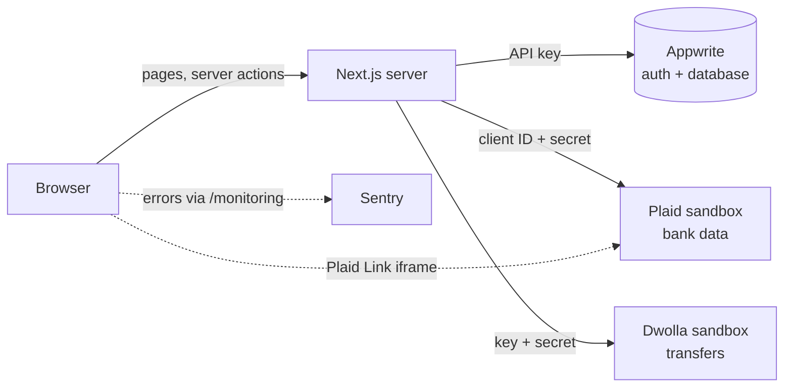

# Ledgerly

Ledgerly links bank accounts through Plaid, shows balances and transactions in one place, and sends transfers between Ledgerly users through Dwolla.

> **Sandbox only.** Ledgerly runs against the Plaid and Dwolla sandboxes. The banks, balances and transactions are test data, and no real money moves. It is a portfolio project, not a licensed financial service.

Built with Next.js 16 (App Router), React 19, TypeScript, Tailwind CSS 4, Appwrite, Plaid, Dwolla and Sentry. It started from the [JavaScript Mastery](https://www.youtube.com/@javascriptmastery) banking tutorial and has since been reworked for security, accessibility and testing. [DEVELOPMENT_PROGRESS.md](DEVELOPMENT_PROGRESS.md) records what changed and why.

## Features

- **Accounts:** sign up (your identity is checked by Dwolla's sandbox), sign in, sign out and change your password.
- **Bank linking** with Plaid Link: link one or more sandbox banks and see their balances.
- **Dashboard:** total balance, recent transactions per bank, spending by category, and a six-month cash-flow chart (income vs. expenses, settled transactions only).
- **Transaction history:** search by merchant or category, filter by money in/out, category and date range. Filters live in the URL, so they survive reloads and can be bookmarked.
- **Transfers:** send money from one of your banks to another user's bank, using the *shareable ID* they give you.
- **Settings:** see your profile and change your password.
- Works on phones and has accessible navigation, forms and focus states.

## Contents

- [Architecture](#architecture)
- [Getting started](#getting-started)
- [Scripts](#scripts)
- [Testing](#testing)
- [Security](#security)
- [Known limitations](#known-limitations)
- [Project structure](#project-structure)
- [License](#license)

## Architecture



Everything that touches Appwrite, Plaid or Dwolla runs on the server. The browser never sees an API key, a Plaid access token or a Dwolla URL. It only gets the pages, plus the results of a few server actions.

**Layers** (all in `lib/`):

| Layer | Files | Role |
|---|---|---|
| Clients | `appwrite.ts`, `plaid.ts`, `dwolla.ts` | One configured client per service. `plaid.ts` wraps every call so errors never carry the Plaid secret. |
| Data access | `data/user.ts`, `data/bank.ts`, `data/transaction.ts` | Server-only reads and writes. Every bank lookup checks ownership; `getCurrentUser()` is cached per request. |
| Server actions | `actions/user.actions.ts`, `actions/transfer.actions.ts` | The only functions the browser can call. They take identity from the session cookie (never from arguments) and validate input with the same Zod schemas the forms use. |
| Pure logic | `transactions.ts`, `utils.ts`, `crypto.ts`, `rate-limit.ts` | Filters and cash-flow totals, schemas, token encryption, rate limits. |

**Request flow.** `proxy.ts` sends visitors without a session cookie to `/sign-in` and sets a per-request Content Security Policy. Pages under `app/(root)/` call `requireUser()`, load data through `lib/data`, and pass only the fields each component needs (for example `PublicUser`, which carries a name and email but no address or Dwolla IDs).

**A transfer, step by step.**
1. `PaymentTransferForm` validates the input and calls `transferFunds`.
2. `transferFunds` checks the session and validates the input again.
3. It confirms that the source bank belongs to you.
4. It finds the receiving bank from the shareable ID.
5. It creates the Dwolla transfer, records it in Appwrite, and refreshes the pages.

### Data model (Appwrite)

| Collection | Fields | Notes |
|---|---|---|
| `users` | `userId`, `email`, `firstName`, `lastName`, `address1`, `city`, `state`, `postalCode`, `dateOfBirth`, `dwollaCustomerId`, `dwollaCustomerUrl` | `userId` is the Appwrite account ID. The SSN is sent to Dwolla for verification and never stored. |
| `banks` | `userId` (relationship → `users`, many-to-one), `bankId`, `accountId`, `accessToken`, `fundingSourceUrl`, `shareableId` | `accessToken` is encrypted with AES-256-GCM. `shareableId` is the Plaid account ID in base64, safe to share. |
| `transactions` | `name`, `amount`, `channel`, `category`, `senderId`, `senderBankId`, `receiverId`, `receiverBankId`, `email` | Transfers made in Ledgerly. Bank transactions themselves come live from Plaid. |

All string attributes except where noted; sizes of 255 or more are fine.

## Getting started

### Prerequisites

- Node.js 20.9 or later (developed on 22) and npm
- Free accounts on [Appwrite Cloud](https://cloud.appwrite.io), [Plaid](https://dashboard.plaid.com/signup) and [Dwolla sandbox](https://accounts-sandbox.dwolla.com/sign-up)
- Optional: a [Sentry](https://sentry.io) project for error reporting

### 1. Install

```bash
git clone https://github.com/theeduazizjon-cell/JSM_banking.git
cd JSM_banking
npm install
cp .env.example .env.local
```

Fill in `.env.local` as you go through the next steps. It is ignored by git; never commit it.

### 2. Appwrite

1. Create a project and copy its **project ID** and **API endpoint** (the regional one, e.g. `https://nyc.cloud.appwrite.io/v1`) into `NEXT_PUBLIC_APPWRITE_PROJECT` and `NEXT_PUBLIC_APPWRITE_ENDPOINT`.
2. Create a database and the three collections from [Data model](#data-model-appwrite), each with the fields listed there. Mark them required, except the `userId` relationship on `banks`. Copy the four IDs into the `APPWRITE_*_ID` variables.
3. Leave the collections' permissions empty. Only the server, through the API key, should read or write them.
4. Create an API key with the scopes `users.read`, `users.write`, `sessions.write`, `documents.read` and `documents.write`, and put it in `NEXT_APPWRITE_KEY`.
5. Recommended: under **Auth → Security**, shorten the session length (the default is one year).

### 3. Plaid

1. Copy the sandbox **client ID** and **secret** from [Developers → Keys](https://dashboard.plaid.com/developers/keys) into `PLAID_CLIENT_ID` and `PLAID_SECRET`, and keep `PLAID_ENV=sandbox`.
2. Enable the **Dwolla** integration under [Developers → Integrations](https://dashboard.plaid.com/developers/integrations). Without it, linking a bank fails with `INVALID_PRODUCT`.

### 4. Dwolla

Create an application in the [Dwolla sandbox dashboard](https://dashboard-sandbox.dwolla.com/applications-legacy). Copy its key and secret into `DWOLLA_KEY` and `DWOLLA_SECRET`, and keep `DWOLLA_ENV=sandbox`.

### 5. Encryption key

Plaid access tokens are encrypted before they are stored. Generate a key and put it in `ENCRYPTION_KEY`:

```bash
openssl rand -base64 32
```

Keep this key safe and don't change it later: tokens encrypted with one key can't be read with another.

### 6. Sentry (optional)

Put your project's DSN in `NEXT_PUBLIC_SENTRY_DSN`; leave it empty to turn Sentry off. To upload source maps when building, also set `SENTRY_AUTH_TOKEN`, and change `org` and `project` in `next.config.ts` to your own.

### 7. Run

```bash
npm run dev
```

Open http://localhost:3000 and sign up. Use sandbox-style details: a real two-letter US state, a 5-digit ZIP and any 4-digit SSN such as `1234`. Then go to **My Banks → Connect bank** and choose any bank in Plaid Link, signing in with Plaid's test login `user_good` / `pass_good`.

To try a transfer, sign up a second user and link a bank for them. Copy the shareable ID from their My Banks page, then send money to it from the first user.

## Scripts

| Command | What it does |
|---|---|
| `npm run dev` | Development server on port 3000 |
| `npm run build` / `npm start` | Production build and server |
| `npm run lint` | ESLint |
| `npm run typecheck` | TypeScript, no output files |
| `npm test` | Unit and component tests (Vitest) |
| `npm run test:watch` | Unit tests in watch mode |
| `npm run test:e2e` | End-to-end tests (Playwright) |

## Testing

**Unit and component tests** (`tests/unit`, `tests/components`) run in about 5 seconds with no network access: Appwrite, Plaid and Dwolla are mocked. They cover:
- transaction filters and cash-flow totals;
- the form schemas;
- token encryption (including tamper detection);
- the Plaid error wrapper;
- bank ownership checks;
- every server action, including validation, rate limits and error messages;
- the main interactive components.

**End-to-end tests** (`tests/e2e`) drive Google Chrome against the running app and a real Appwrite project. They cover:
- the sign-in redirects and a forged session cookie;
- sign-in, sign-up validation, navigation, settings and logout;
- another user's bank ID showing nothing;
- private fields staying out of the HTML;
- response headers and Content Security Policy violations.

They sign in as a dedicated sandbox account, so create one through the app and add it to `.env.local`:

```bash
TEST_USER_EMAIL=you+ledgerly-test@example.com
TEST_USER_PASSWORD=a-long-test-password
```

Then run them. Playwright starts `npm run dev`, or reuses a server already on port 3000. Set `E2E_PORT` to use another port, for example a production build started with `npm start -- -p 3100`.

To test a deployed site instead, set `E2E_BASE_URL` (for example `E2E_BASE_URL=https://your-app.vercel.app npm run test:e2e`). No local server is started then, and the test account must exist in the Appwrite project the site uses.

```bash
npm run test:e2e
```

Playwright uses your installed Chrome. To use Playwright's own browser instead, run `npx playwright install chromium` and remove `channel: "chrome"` from `playwright.config.ts`.

Each run signs in twice and makes one deliberately wrong attempt, which counts towards the sign-in rate limit, so avoid running it many times in a row.

## Security

- **Authorization on the server.** Every server action reads the user from the session cookie, never from its arguments. Every bank lookup checks ownership, so a bank ID copied from someone else's URL shows nothing.
- **Validation twice.** The forms and the server actions use the same Zod schemas. Transfers are limited to $5,000 with at most two decimal places.
- **Secrets.** API keys stay on the server (`import "server-only"`). Plaid access tokens are encrypted at rest. Plaid errors are rewritten so logs never contain the Plaid secret. The dev server doesn't print server action arguments.
- **Sessions.** The session cookie is `HttpOnly`, `Secure` and `SameSite=Strict`. Next.js rejects server action calls from other origins.
- **Rate limits.**
  - Sign-in: 5 failed attempts per email per 15 minutes, and 30 attempts per IP.
  - Sign-up: 5 per IP per hour.
  - Password change: 5 wrong current passwords per user.
  - Transfers: 10 per user per hour.
- **Headers.** A nonce-based Content Security Policy, plus HSTS, `X-Frame-Options: DENY`, `nosniff`, a strict referrer policy and a restrictive permissions policy.
- **Privacy.** The SSN is never stored. Pages receive only the fields they show. Sentry collects no user info, cookies or request bodies, and session replays mask all text.

To report a security problem, please open a private security advisory on GitHub rather than a public issue.

## Known limitations

- **Sandbox only:** switching to production would need Plaid and Dwolla production approval, plus a compliance review.
- **Rate limits are kept in memory:** each server instance keeps its own counters. On a multi-instance host, move them to a shared store such as Redis.
- **Plaid transactions are re-synced on every page view:** there is no stored sync cursor, so accounts with many transactions load slowly.
- **Transfers have no idempotency key:** if a transfer succeeds at Dwolla but can't be recorded, the user is told not to resend it, and it has to be recorded by hand.
- **No profile editing:** names and addresses are verified with Dwolla, so changing them would also need a Dwolla update.

## Project structure

```
app/
  (auth)/            sign-in and sign-up pages
  (root)/            signed-in pages: dashboard, my-banks, transaction-history,
                     payment-transfer, settings; loading and error states
  layout.tsx         fonts, metadata, per-request rendering for the CSP nonce
components/          UI; components/ui holds the shadcn primitives
lib/
  actions/           server actions (the browser-callable API)
  data/              server-only data access with ownership checks
  appwrite.ts plaid.ts dwolla.ts   service clients
  crypto.ts          AES-256-GCM token encryption
  rate-limit.ts      in-memory rate limiting
  transactions.ts    filters and cash-flow totals
  utils.ts           schemas and formatting helpers
types/index.d.ts     shared types
proxy.ts             sign-in redirect and Content Security Policy
tests/               unit, component and end-to-end tests
```

## License

[MIT](LICENSE)
